<h1 align="center">Lumora Hotels: Revenue and Guest Data Science</h1>
<p align="center"><em>2021–2025 · Python · pandas · scikit-learn · SciPy · matplotlib · seaborn · Plotly · Streamlit</em></p>


<div align="center">
  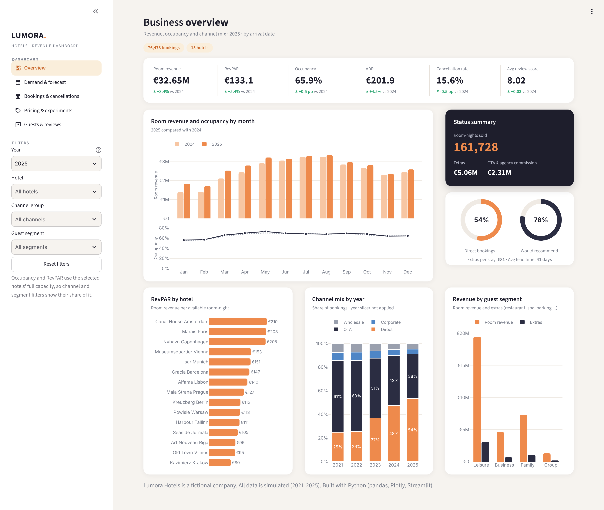
</div>

<table align="center">
  <tr>
    <td width="1440">
      <h2 align="center">Client Background</h2>
      Lumora runs <strong>15 boutique hotels</strong> (32–64 rooms each) in <strong>15 European cities</strong>, from Vilnius, Riga and Tallinn to Paris, Lisbon and Barcelona. Guests book on the Lumora website and app, by phone, through two online travel agencies (OTAs), through corporate travel agencies and through tour operators.<br>
      <br>
      Between 2021 and 2025 the group took <strong>305,000 bookings</strong> worth <strong>€111.5 million</strong> in room revenue, plus <strong>€19.3 million</strong> in extras such as breakfast, restaurant, spa and parking. The data covers guests, bookings, prices shown on the website, competitor prices, reviews with text, extra charges, staffing, local events, marketing spend and four website A/B tests.<br>
      <br>
      Working with the <strong>Revenue Management and Guest Experience teams</strong>, I built models to answer five questions. Which bookings will be cancelled? How many rooms will we sell each night? How sensitive are guests to price? Which website experiments worked? What makes guests happy, and who are our most valuable guests? These were the main areas of focus:
      <h3>Northstar Metrics</h3>
      <ul>
        <li><strong>Revenue:</strong> room revenue, RevPAR (revenue per available room), ADR (average daily rate) and occupancy.</li>
        <li><strong>Cancellations:</strong> cancellation and no-show rates, and how many cancellations a model catches for a given amount of follow-up work.</li>
        <li><strong>Demand forecast:</strong> forecast error (WAPE) per hotel and night, against a "same day last year" baseline.</li>
        <li><strong>Pricing and conversion:</strong> share of website price quotes that become bookings, price elasticity and revenue per quote.</li>
        <li><strong>Guest experience:</strong> review score, share of guests who would recommend, and extra spend per stay.</li>
      </ul>
    </td>
  </tr>
</table>

<h1 align="center">Executive Summary</h1>
<h3 align="center">Room Revenue and Occupancy by Month</h3>
<div align="center">
  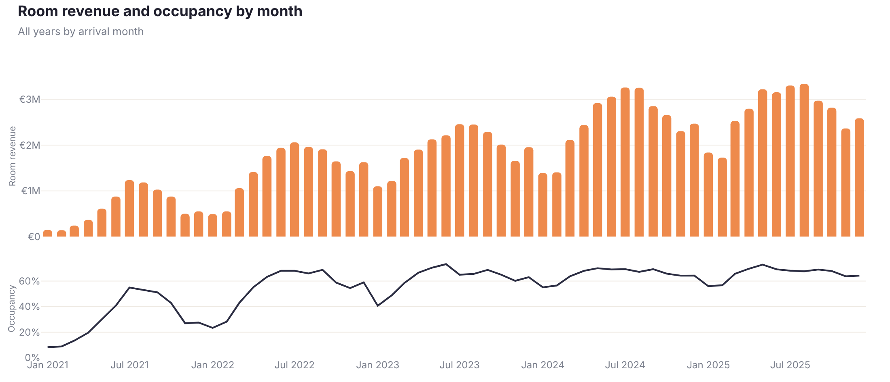
</div>
<table align="center">
  <tr>
    <td width="460" valign="top">
      <ol>
        <li>
          <strong>Revenue Quadrupled After COVID</strong>
          <ul>
            <li>Room revenue grew from <strong>€7.8M in 2021 to €32.6M in 2025</strong>. Occupancy rose from 31.6% to 65.9% and ADR from €135 to €202.</li>
            <li>Direct bookings grew from <strong>25% to 54%</strong> after the app and loyalty club launched in April 2023, which kept OTA commission flat while revenue grew 41%.</li>
          </ul>
        </li>
        <li>
          <strong>Cancellations Can Be Predicted</strong>
          <ul>
            <li>The model reaches <strong>AUC 0.77</strong> on 2025 bookings it never saw. The riskiest 20% of bookings hold <strong>47% of all cancellations</strong>.</li>
            <li>A simple logistic regression scores the same, so the hotels can use a model that is easy to explain.</li>
          </ul>
        </li>
        <li>
          <strong>The Demand Forecast Beats Last Year's Pattern</strong>
          <ul>
            <li>Daily forecast error is <strong>14.6%</strong> against 18.6% for "same day last year", and <strong>6.8%</strong> at hotel-month level.</li>
          </ul>
        </li>
      </ol>
    </td>
    <td width="460" valign="top">
      <ol start="4">
        <li>
          <strong>Guests Are Price Sensitive, but Not All of Them</strong>
          <ul>
            <li>In a randomised price test, a 1% higher price cut bookings by <strong>1.4%</strong>. The −8% price earned <strong>4% more revenue per quote</strong> than the current price.</li>
            <li>Weekend stays are much more sensitive (−1.8) than weekday stays (−1.1).</li>
          </ul>
        </li>
        <li>
          <strong>Two Website Experiments Worked, One Did Nothing</strong>
          <ul>
            <li>The new checkout page (+3.2 pp) and the member price badge (+3.2 pp) raised conversion. The "only X rooms left" message changed nothing.</li>
          </ul>
        </li>
        <li>
          <strong>Staff Turnover Hurts Reviews</strong>
          <ul>
            <li>When staff turnover more than doubled in 2022, the average review score fell from <strong>8.3 to 6.9</strong> at the low point. Each extra point of monthly turnover costs <strong>0.23 points</strong> of review score.</li>
          </ul>
        </li>
      </ol>
    </td>
  </tr>
</table>

<h2 align="center">Dataset Structure and ERD (Entity Relationship Diagram)</h2>
The database has <strong>17 tables</strong> with about <strong>1.58 million rows</strong> in total. <code>bookings</code> (306,798 rows) is the central fact table. <code>rate_quotes</code> (484,812 rows) holds every price the website and app showed to a visitor, linked to the booking when the visitor booked. <code>stay_charges</code> and <code>reviews</code> describe what happened during and after the stay. Competitor prices, staffing, events, marketing, calendar and exchange rates add context.
<div align="center">
  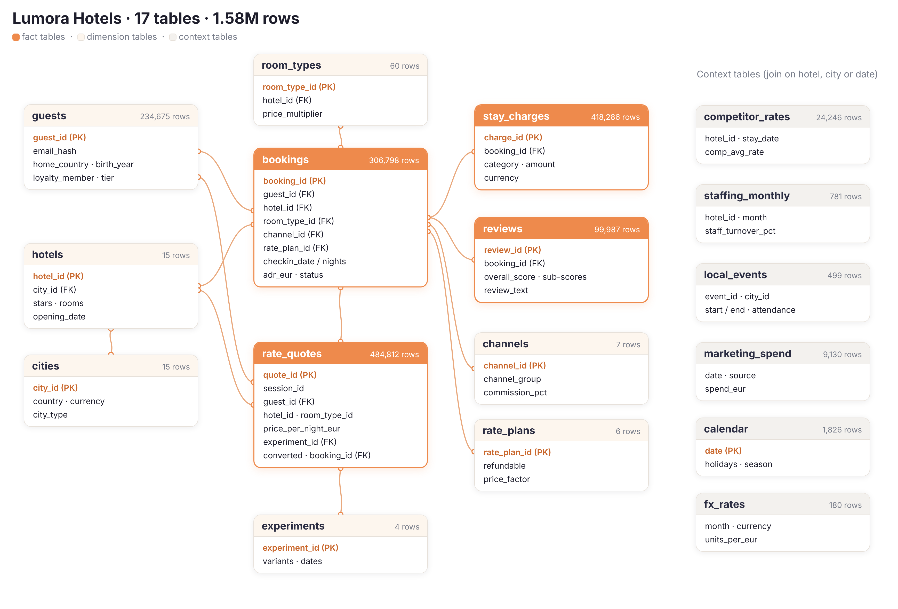
</div>

<h1 align="center">Insights Deep-Dive</h1>

<h1 align="center">Business Overview</h1>
<table>
  <tr>
    <td>
      <strong>Growth</strong>
      <ol>
        <li>2021 was a COVID year: occupancy was <strong>31.6%</strong> and 30% of bookings were cancelled. Bookings rose from 32K in 2021 to <strong>76K in 2025</strong>.</li>
        <li>Four hotels opened during the period: Krakow and Munich in 2022, Lisbon and Barcelona in 2024. RevPAR rose from <strong>€42 to €133</strong>.</li>
      </ol>
      <strong>Channels</strong>
      <ol>
        <li>OTAs brought 61% of bookings in 2021 and <strong>38% in 2025</strong>. The mobile app reached 27% of bookings within three years of launch.</li>
        <li>OTA commission stayed between <strong>€2.1M and €2.4M</strong> a year from 2022 on, while room revenue grew from €17.9M to €32.6M.</li>
      </ol>
    </td>
  </tr>
</table>
<table align="center">
  <tr align="center">
    <td width="1000">
      <h3>Channel Mix by Year</h3>
      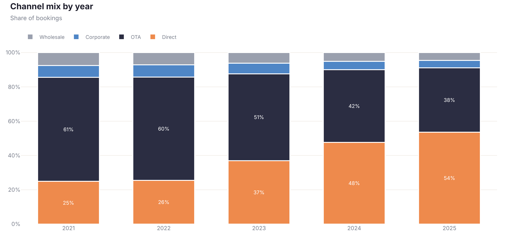
    </td>
    <td width="1000">
      <h3>Extras Revenue by Category</h3>
      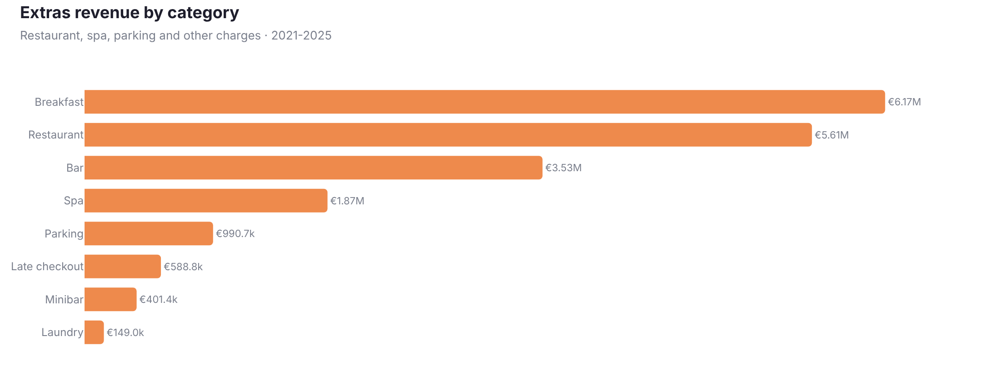
    </td>
  </tr>
</table>
<table>
  <tr>
    <td>
      <ul>
        <li>Extras add about <strong>€80 per stay</strong>. Breakfast (€6.2M) and the restaurant (€5.6M) bring the most. The spa is only in four hotels but still earned €1.9M.</li>
      </ul>
    </td>
  </tr>
</table>

<h1 align="center">Demand and Forecasting</h1>
<div align="center">
  <h3>2025 Rooms Sold per Week: Actual vs Forecast</h3>
  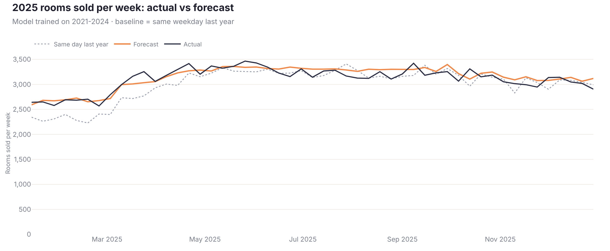
</div>
<table align="center">
  <tr>
    <td width="333" valign="top">
      <h3>Seasonality</h3>
      <ul>
        <li>Occupancy runs from about <strong>46% in January to 70% in May–September</strong>.</li>
        <li>The seaside hotel in Jurmala goes from <strong>23% in January to 72% in July</strong>, so it needs its own pricing calendar.</li>
      </ul>
    </td>
    <td width="333" valign="top">
      <h3>Events</h3>
      <ul>
        <li>Nights with a conference, festival, concert or match in the city run at <strong>77% occupancy</strong>, against 56% on other nights.</li>
        <li>The event calendar is one of the forecast's inputs, so these peaks are planned for, not missed.</li>
      </ul>
    </td>
    <td width="333" valign="top">
      <h3>Forecast Model</h3>
      <ul>
        <li>A gradient boosting model uses only what is known a year ahead: calendar, holidays, events, competitor prices and last year's occupancy.</li>
        <li>It beats the naive forecast in 14 of 15 hotels. Barcelona is the exception: it opened in 2024, so the model has only one season to learn from.</li>
      </ul>
    </td>
  </tr>
</table>
<table align="center">
  <tr align="center">
    <td width="1000">
      <h3>Occupancy by Hotel and Month</h3>
      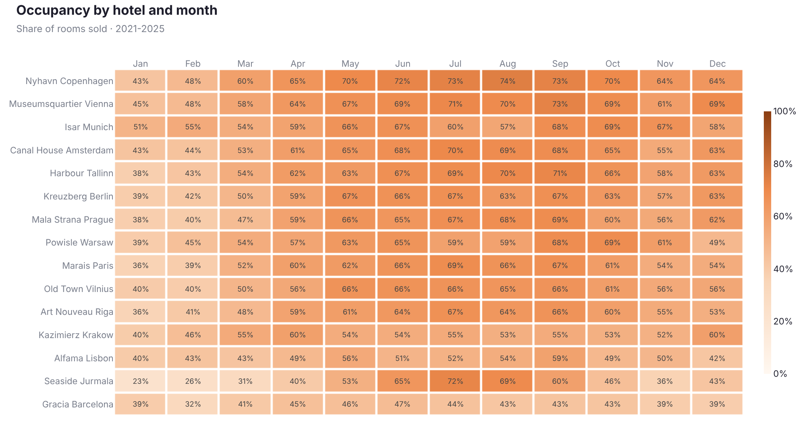
    </td>
    <td width="1000">
      <h3>City Events Lift Demand</h3>
      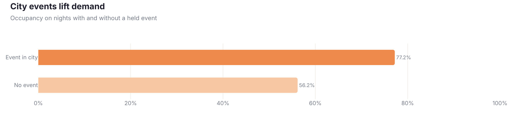
    </td>
  </tr>
</table>

<h1 align="center">Cancellations</h1>
<table align="center">
  <tr align="center">
    <td width="1000">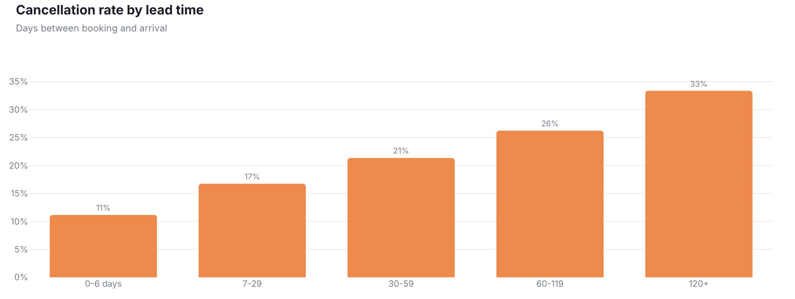</td>
    <td width="1000">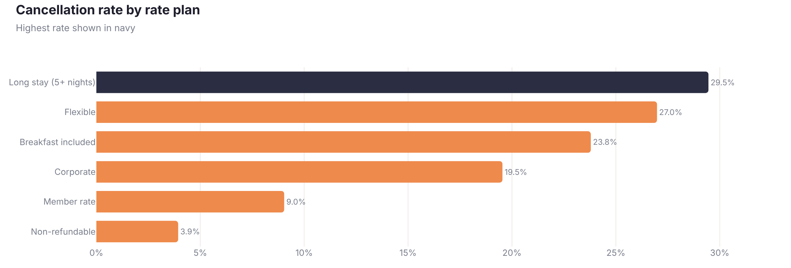</td>
  </tr>
</table>
<table>
  <tr>
    <td valign="top" width="500">
      <strong>Patterns</strong>
      <ul>
        <li>The longer ahead a booking is made, the more likely it is cancelled: <strong>11%</strong> for bookings made less than a week ahead and <strong>33%</strong> for bookings made four months or more ahead.</li>
        <li>Non-refundable rates are cancelled only <strong>4%</strong> of the time, against 27% for flexible rates.</li>
        <li>Tour operator bookings are cancelled most (38%) and app bookings least (9%).</li>
        <li>Loyalty members cancel <strong>8%</strong> of bookings, non-members 21%. Guests who add special requests cancel less: 22% with none, 12% with three or more.</li>
      </ul>
    </td>
    <td valign="top" width="500">
      <strong>Model</strong>
      <ul>
        <li><strong>Time split:</strong> trained on 2021–2024 arrivals (229K bookings), tested on 2025 (76K).</li>
        <li><strong>No leakage:</strong> only information known at booking time. The cancellation date is left out, and the guest's past cancellations count only earlier bookings.</li>
        <li><strong>Results:</strong> gradient boosting AUC 0.771, logistic regression 0.771, PR-AUC 0.37 against a base rate of 15.6%. Predicted and actual cancel rates match closely in every risk group.</li>
        <li>Rate plan, lead time, channel and special requests drive most of the prediction.</li>
      </ul>
    </td>
  </tr>
</table>
<table align="center">
  <tr align="center">
    <td width="1000">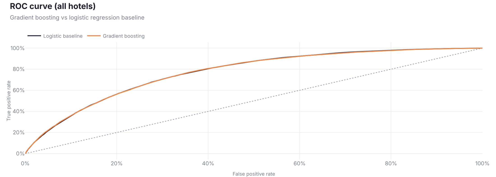</td>
    <td width="1000">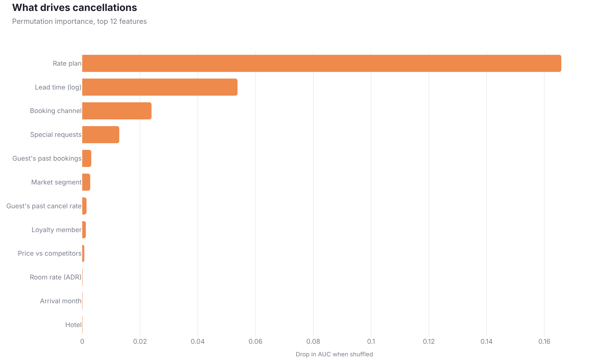</td>
  </tr>
</table>

<h1 align="center">Pricing and Experiments</h1>
<table align="center">
  <tr align="center">
    <td width="1000">
      <h3>Our Price vs Competitors</h3>
      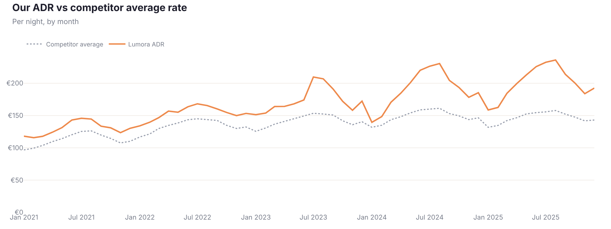
    </td>
    <td width="1000">
      <h3>A/B Test Results</h3>
      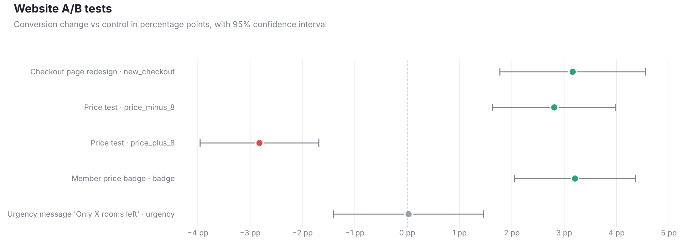
    </td>
  </tr>
</table>
<table>
  <tr>
    <td valign="top" width="500">
      <ul>
        <li>Before July 2023 Lumora priced about <strong>3% below</strong> nearby competitors. After the revenue management system went live, prices moved with demand and averaged <strong>12% above</strong> competitors.</li>
        <li>Conversion falls from <strong>37%</strong> when Lumora is more than 20% cheaper than competitors to <strong>17%</strong> when it is more than 35% more expensive.</li>
        <li>That observational curve is biased, because prices are highest exactly when demand is strongest. The randomised price test gives the clean answer.</li>
      </ul>
    </td>
    <td valign="top" width="500">
      <ul>
        <li><strong>EXP01 new checkout</strong> (2023): conversion 23.3% → 26.5%, +3.2 pp (95% CI 1.8 to 4.6).</li>
        <li><strong>EXP02 price test</strong> (2024): −8% price raised conversion by 2.8 pp, +8% cut it by 2.8 pp.</li>
        <li><strong>EXP03 member price badge</strong> (2025): +3.2 pp (CI 2.1 to 4.4).</li>
        <li><strong>EXP04 urgency message</strong> (2025): +0.03 pp, p = 0.97. No effect.</li>
      </ul>
    </td>
  </tr>
</table>
<table align="center">
  <tr align="center">
    <td width="1000">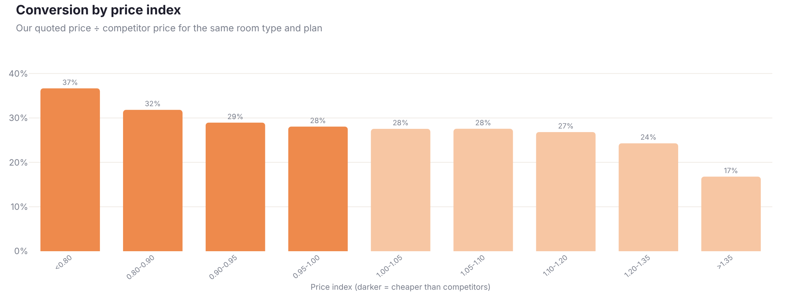</td>
    <td width="1000">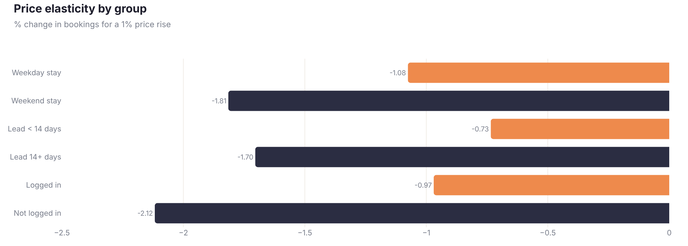</td>
  </tr>
</table>
<table>
  <tr>
    <td>
      <ul>
        <li>Revenue per price shown was <strong>€142</strong> at −8%, €136 at the current price and €132 at +8%.</li>
        <li>Guests who are logged in (elasticity −1.0) and guests booking less than two weeks ahead (−0.7) care much less about price than anonymous visitors (−2.1) and early planners (−1.7).</li>
      </ul>
    </td>
  </tr>
</table>

<h1 align="center">Guests and Reviews</h1>
<div align="center">
  <h3>The 2022 Staff Shortage Hit Review Scores</h3>
  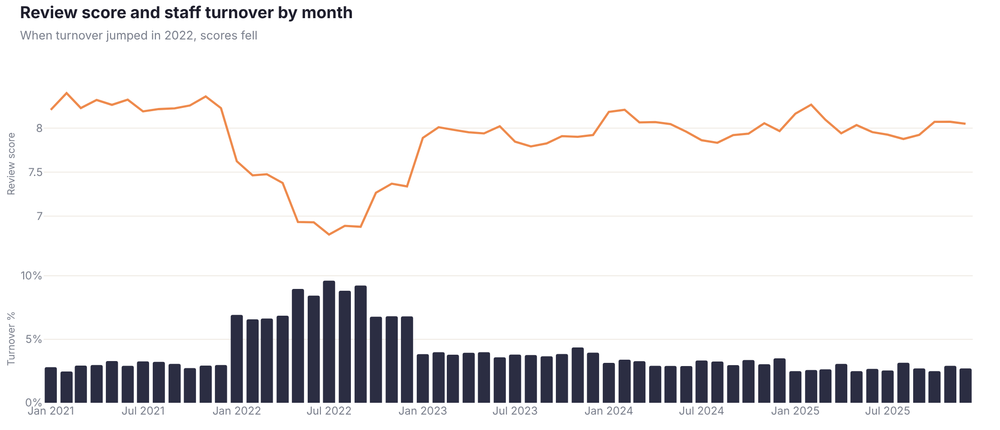
</div>
<table align="center">
  <tr>
    <td width="500">
      <div align="center">
        <h3>What Drives the Review Score</h3>
        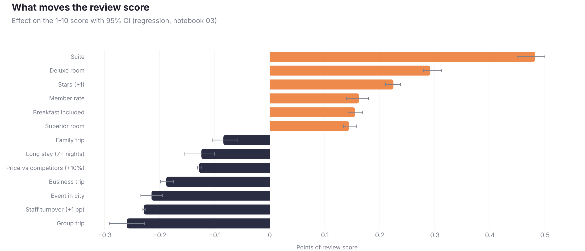
      </div>
    </td>
    <td valign="top" width="500">
      <ul>
        <li>Monthly staff turnover averaged <strong>7.7% in 2022</strong>, against 3% in 2021. Review scores fell to <strong>6.85</strong> in the third quarter of 2022 and recovered to 7.96 by early 2023.</li>
        <li>A linear regression on 100K reviews shows the drivers. Suites add <strong>+0.48</strong> points and each extra star +0.23. Each point of staff turnover costs 0.23 points, and a price 10% above competitors costs 0.13.</li>
        <li>Group and business guests score lower, and so do stays during big city events, when hotels are full and busy.</li>
        <li>The most common phrases in reviews are about location ("Great neighbourhood", "Perfect location"). The most common complaints are slow check-in, overwhelmed staff and unfriendly reception, which matches the staffing story.</li>
      </ul>
    </td>
  </tr>
</table>
<table align="center">
  <tr>
    <td width="500" valign="top">
      <div align="center">
        <h3>Guest Segments (K-means)</h3>
        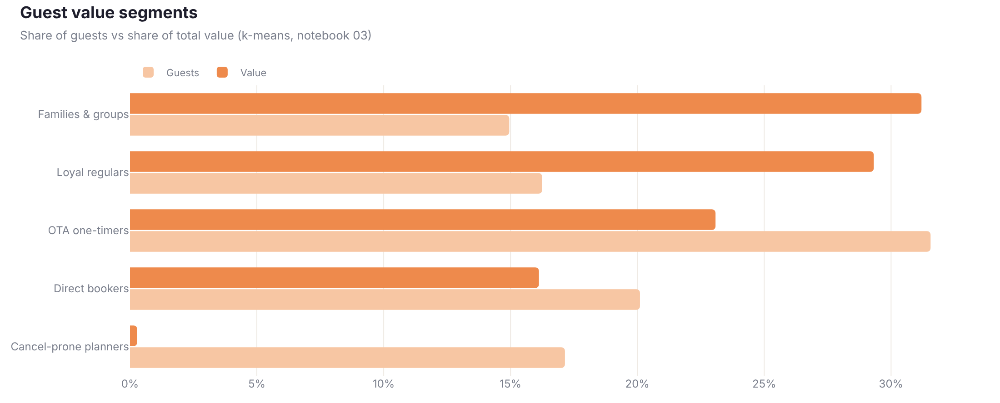
      </div>
    </td>
    <td valign="top" width="500">
      <ul>
        <li>I clustered 235K guests on bookings, value, lead time, party size, weekday share, direct share and cancel rate.</li>
        <li><strong>Families & groups</strong> (35K guests) are worth €1,177 each and bring <strong>31% of all value</strong>. They book 75 days ahead and stay 4.4 nights.</li>
        <li><strong>Loyal regulars</strong> (38K) book 2.7 times on average and bring <strong>29%</strong> of value.</li>
        <li><strong>Cancel-prone planners</strong> (40K) cancel every booking and bring almost no revenue.</li>
        <li>Most other guests book once: through OTAs (73K) or directly (47K), worth about €410–450 each.</li>
      </ul>
    </td>
  </tr>
</table>

<h1>What I Learned</h1>
<ul>
  <li><strong>Split by time, never randomly.</strong> Every model is trained on 2021–2024 and tested on 2025, so the results show how the model would have done in a real year.</li>
  <li><strong>Prices set from demand make naive price analysis wrong.</strong> After dynamic pricing starts, high prices and high demand go together. Only the randomised price test separates the effect of price.</li>
  <li><strong>A simple model is often enough.</strong> Logistic regression matched gradient boosting on cancellations. The value came from good features, such as the guest's past cancellations counted without look-ahead.</li>
  <li><strong>Sold-out nights hide demand.</strong> On 15% of quotes the room was already sold out, so bookings understate demand on peak nights.</li>
  <li><strong>New hotels are hard to forecast.</strong> Barcelona and Lisbon had only one year of history, and the forecast error there was two to three times higher than in mature hotels.</li>
  <li><strong>Clean data before you trust it.</strong> I fixed 20 problems, including 1,500 duplicate bookings, 2,782 duplicate guest profiles, a review site using a 1–5 scale, prices in three local currencies and 9,457 quotes from scraper bots.</li>
</ul>

<h1>Recommendations</h1>
<h4>Based on these results, here are actions the Revenue Management and Guest Experience teams can take.</h4>
<ul>
  <h3>Revenue</h3>
  <li>Score every new booking for cancellation risk and act on the riskiest 20%.
    <ul>
      <li>They hold 47% of cancellations. Ask for a deposit, send a reminder a week before arrival, or overbook slightly on nights with many risky bookings.</li>
    </ul>
  </li>
  <li>Use targeted discounts for weekend leisure stays and early bookers, and keep weekday prices.
    <ul>
      <li>Weekend stays have an elasticity of −1.8 against −1.1 for weekdays, and the −8% test arm earned 4% more revenue per quote.</li>
    </ul>
  </li>
  <li>Keep pushing direct bookings through the app and Lumora Club.
    <ul>
      <li>App bookings cancel least (9%), members cancel 8% against 21%, and direct bookings pay no OTA commission (18% for the biggest OTA).</li>
    </ul>
  </li>
  <h3>Website</h3>
  <li>Keep the new checkout and the member price badge. Remove the urgency message.
    <ul>
      <li>Each of the first two raised conversion by about 3 pp. The urgency message showed no effect in 15K quotes.</li>
    </ul>
  </li>
  <h3>Guest Experience</h3>
  <li>Track staff turnover as an early warning for review scores.
    <ul>
      <li>Each point of monthly turnover costs 0.23 points of review score, and the 2022 crisis cost almost 1.5 points at its worst.</li>
    </ul>
  </li>
  <li>Plan extra staff for big city events and target families with packages.
    <ul>
      <li>Event nights run at 77% occupancy and score lower. Families & groups bring 31% of guest value.</li>
    </ul>
  </li>
</ul>

<h1>Technical Details</h1>

<h3>Pipeline</h3>

| Step | File | What it does |
|---|---|---|
| 0 | `src/config.py`, `src/theme.py` | Folder paths (works from the project root or `notebooks/`) and the chart style for the notebooks |
| 1 | `src/load.py` | Reads the 17 CSVs and parses dates |
| 2 | `src/clean.py` | Fixes 20 data-quality problems and writes `cleaning_log.csv` |
| 3 | `src/features.py` | Booking features, hotel-night demand table and quote features, all without look-ahead |
| 4 | `src/models.py` | Cancellation model, demand forecast, price elasticity, A/B tests, review drivers, guest segments |
| 5 | `streamlit_app/` | 5-page Streamlit dashboard; `export_figures.py` saves every chart as a PNG |
| 6 | `run_all.py` | Runs everything in order (`--notebooks` also runs the four notebooks) |

Notebooks: `01_cleaning`, `02_exploration`, `03_modelling` and `04_dashboard` walk through the same steps with charts and comments.

<h3>Data Cleaning</h3>

| Problem | Fix |
|---|---|
| 1,500 duplicate bookings | Removed exact duplicates |
| 2,782 duplicate guest profiles (same email hash) | Merged into the oldest profile, bookings and reviews remapped |
| 260 zero rates and 45 rates entered in cents | Zero rates filled with the room type, rate plan and month median; cent values divided by 100 |
| 120 swapped check-in and check-out dates | Swapped back (the nights column was right) |
| Messy segment labels, `adults = 0`, mixed country codes, impossible birth years | Standardised or set to missing |
| TripGlobe reviews on a 1–5 scale in 2021–2022 (7,954) | Multiplied by 2 |
| 300 reviews dated before the stay | Set to checkout plus the median delay |
| Charges and competitor prices in PLN, CZK and DKK | Converted to EUR with monthly FX rates |
| Competitor-rate gaps and 10x spikes | Spikes removed, gaps interpolated per hotel |
| 9,457 bot quotes (50+ quotes, seconds apart, never booked) | Removed |
| Missing staffing months, duplicate events | Interpolated, de-duplicated |

<h3>Dashboard</h3>

The dashboard is a Streamlit app (`streamlit_app/`) with Plotly charts in a light peach, orange and navy style. A sidebar switches between five pages, and four slicers (year, hotel, channel group and guest segment) filter the KPI cards and charts. The KPI cards compare the selected year with the year before. The app reads `Data_clean/` and the model results in `output/tables/`, and loads the data once, so pages switch instantly after the first load.

| Page | Content |
|---|---|
| 1 · Overview | Room revenue, RevPAR, occupancy, ADR, cancellation rate and review score vs the year before, monthly revenue and occupancy, RevPAR by hotel, channel mix, revenue by segment |
| 2 · Demand & Forecast | Hotel × month occupancy heatmap, weekday occupancy, event-night uplift, 2025 forecast vs actual, forecast error by hotel |
| 3 · Bookings & Cancellations | Cancel and no-show trend, cancel rate by lead time, rate plan and channel, model check for 2025 (top 20% risk, AUC, ROC, calibration, feature importance) |
| 4 · Pricing & Experiments | Our ADR vs competitors, conversion vs price index, price test, elasticity, A/B test results with confidence intervals, conversion by device and traffic source |
| 5 · Guests & Reviews | Review score vs staff turnover, score drivers, sub-scores, review phrases, guest segments, extras by category, home countries |

`streamlit_app/export_figures.py` runs every page in the background and saves each chart as a PNG in `output/figures_app/`. The charts in this README come from there.

<table align="center">
  <tr align="center">
    <td width="1000">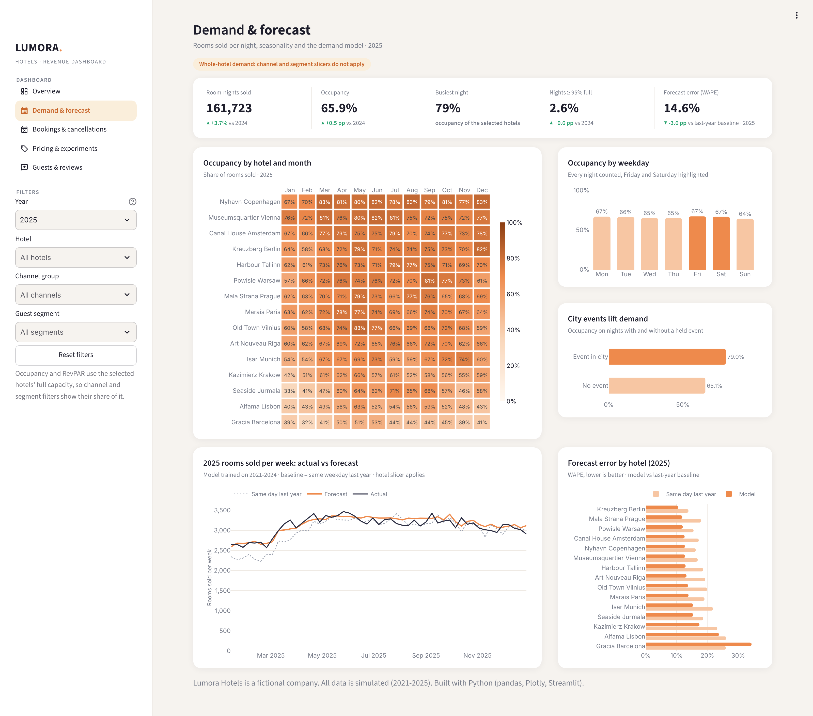</td>
    <td width="1000">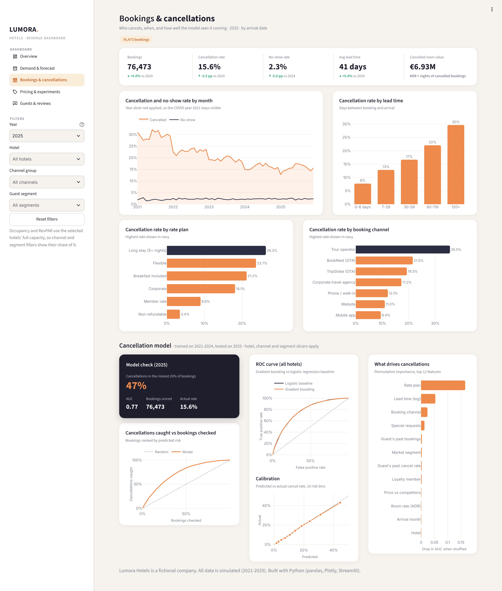</td>
  </tr>
  <tr align="center">
    <td width="1000">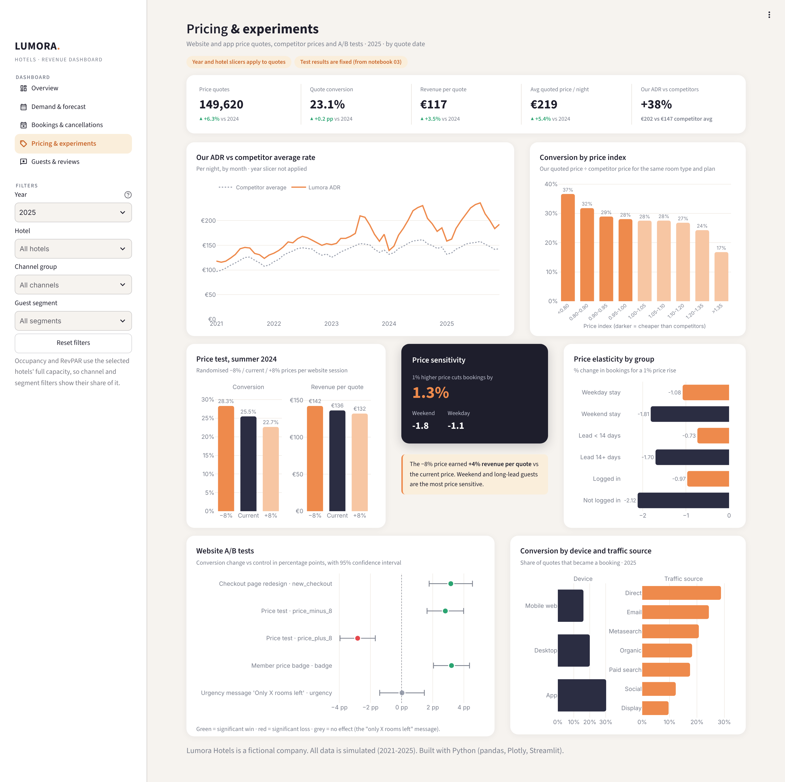</td>
    <td width="1000">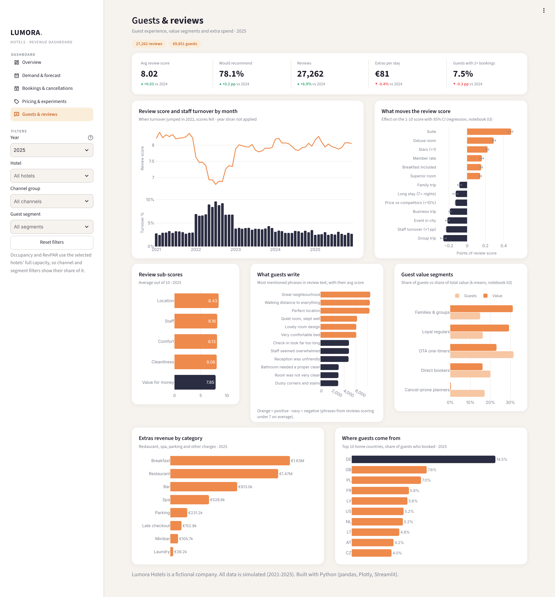</td>
  </tr>
</table>

<h3>How to run</h3>

1. Clone the repository and add the three large CSVs to `Data/` (see Data Availability below).
2. Install the packages: `pip install -r requirements.txt`
3. Run `python run_all.py`. It cleans the data, fits the models and exports the dashboard charts in about two minutes (`python run_all.py --notebooks` also runs the notebooks, about five minutes).
4. Start the dashboard:
   ```
   cd streamlit_app
   streamlit run app.py
   ```
   It opens at `http://localhost:8501`.

Requirements: Python 3.10 or later, with `pandas`, `numpy`, `scipy`, `scikit-learn`, `matplotlib`, `seaborn`, `plotly`, `streamlit`, `kaleido` and `jupyter`. The chart export also needs Google Chrome (`plotly_get_chrome` installs one if it is missing).

<h3>Project structure</h3>

```
lumora-hotels-data-science/
├── Data/                     # raw CSV tables (3 large ones on request)
├── notebooks/                # 01_cleaning … 04_dashboard
├── src/                      # config, theme, load, clean, features, models
├── streamlit_app/            # Streamlit dashboard: app.py, views/, export_figures.py
├── images/                   # charts, ERD and screenshots used in this README
├── data_generation/          # Python script that generated the simulated data
├── run_all.py
├── requirements.txt
└── README.md
```

---

<h3>Data Availability</h3>

Due to GitHub's file size limits, the three largest tables are not included in this repository:

| File | Size |
|---|---|
| `rate_quotes.csv` | 56 MB |
| `bookings.csv` | 41 MB |
| `stay_charges.csv` | 26 MB |

All remaining tables are in the `Data/` folder. The full dataset is available upon request. Feel free to reach out via [LinkedIn](https://www.linkedin.com/in/algirdas-vailionis) or [email](mailto:algirdas.vailionis@gmail.com).

<h3>Author</h3>

<strong>Algirdas Vailionis</strong>, Data Scientist · <a href="https://www.linkedin.com/in/algirdas-vailionis">LinkedIn</a> · <a href="mailto:algirdas.vailionis@gmail.com">Email</a>
